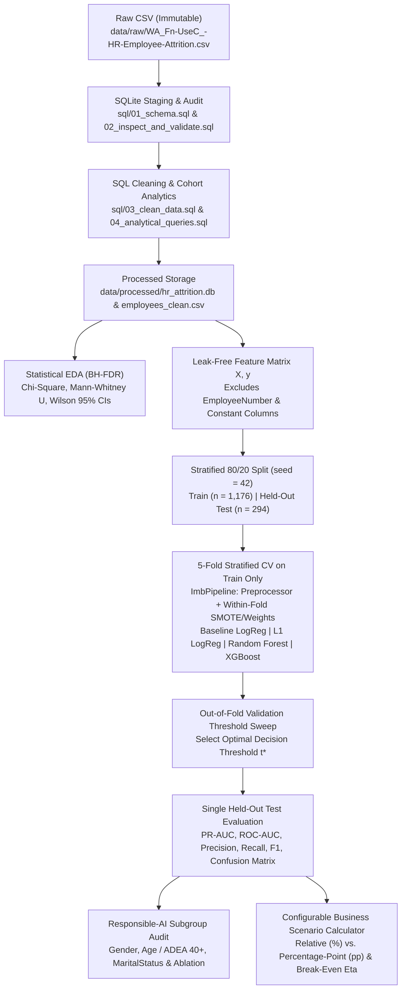
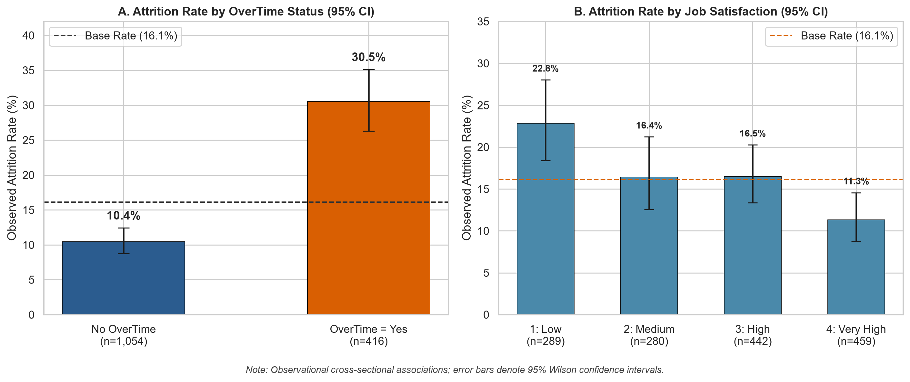
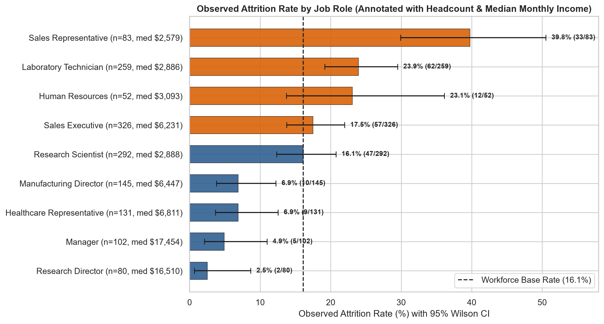
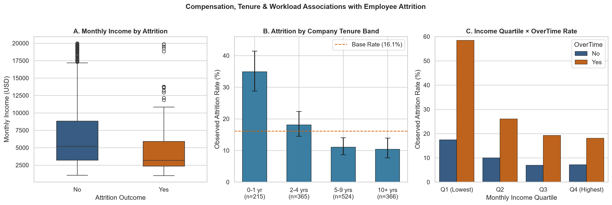
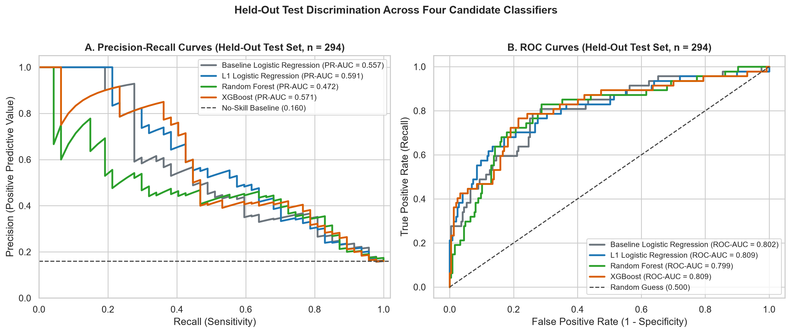
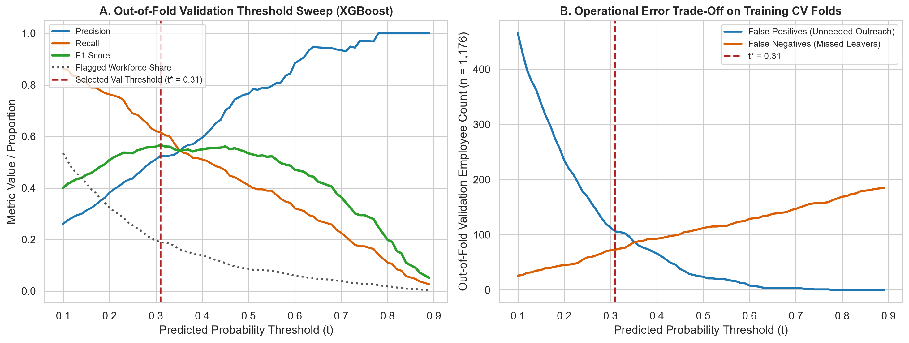
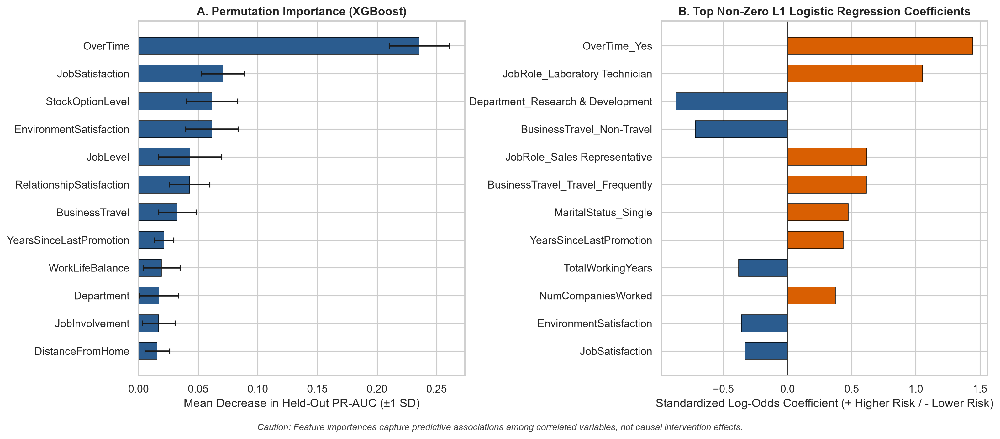
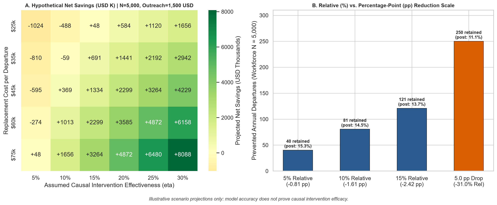
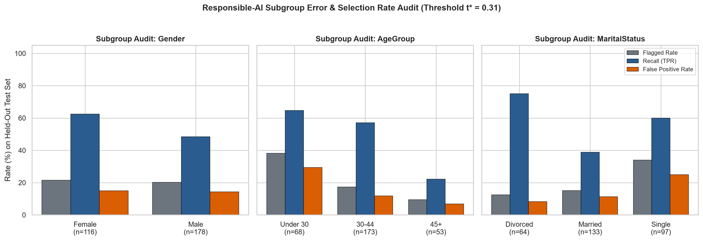

# Workforce Retention: Predicting Employee Attrition

End-to-end, leak-free machine learning and SQL analytics pipeline for **Workforce Retention** using the **IBM HR Analytics Employee Attrition & Performance** dataset (`N = 1,470`). This repository demonstrates production-minded SQLite data engineering, FDR-controlled statistical analysis, binary classification with within-fold imbalance handling, validation-driven threshold optimization, configurable retention scenario modeling, and responsible-AI subgroup auditing.

---

## Project Background (Author-Provided Context)

> [!NOTE]
> **Author-Provided Background:**
> This research was presented at Purdue’s Fall 2025 Research Expo to 200+ attendees, including graduate researchers and faculty, and earned a Distinction Award for outstanding research.

---

## Executive Summary

1. **SQL Data Engineering & Governance**: Raw CSV records (`1,470` rows × `35` columns) are kept immutable in `data/raw/` and ingested into SQLite (`data/processed/hr_attrition.db`). Automated SQL audit scripts verify `0` missing cells, `0` duplicate `EmployeeNumber` keys, and `0` domain violations, strip `3` zero-variance constant columns (`EmployeeCount`, `Over18`, `StandardHours`), and isolate `EmployeeNumber` strictly as a relational primary key excluded from ML feature matrices.
2. **Observational Drivers (Association ≠ Causation)**: Across `27` univariate statistical tests (`20` significant at Benjamini-Hochberg FDR `q < 0.05`), elevated attrition is most strongly associated with **working overtime** (`30.53%` vs. `10.44%`, Cramér's `V = 0.246`), **entry-level/frontline roles** (`Sales Representative` `39.76%`, `Laboratory Technician` `23.94%`), **lower monthly compensation** (median `$3,202` vs. `$5,204`, `|r_rb| = 0.311`), **early company tenure** (`0–1 yr` `34.88%` vs. `10+ yrs` `10.38%`), **zero stock options** (`24.41%` at Level 0), and **low job satisfaction** (`22.84%` vs. `11.33%`).
3. **Leak-Free Classification & Model Selection**: Four classifiers—**Baseline Logistic Regression**, **L1-Regularized Logistic Regression**, **Random Forest**, and **XGBoost**—are evaluated on a stratified 80/20 split (`1,176` train / `294` held-out test, fixed `random_seed = 42`) with imputation, scaling, encoding, class-imbalance handling (`SMOTE` / fold-computed class weights), hyperparameter tuning, and threshold selection (`t*`) restricted strictly to training cross-validation folds:
   - **XGBoost** achieves the highest 5-fold training CV PR-AUC (`0.639 ± 0.060`) and `0.809` held-out ROC-AUC (`0.571` held-out PR-AUC).
   - **L1-Regularized Logistic Regression** achieves close training CV PR-AUC (`0.623 ± 0.062`) and the **highest held-out test PR-AUC (`0.591`)** and **validation-threshold F1 (`0.500`)** while zeroing out `16` of `49` encoded predictors—illustrating why sparse generalized linear models remain competitive, transparent benchmarks on structured HR tabular data.
4. **Business Decision Support & Responsible Use**: Our configurable scenario calculator translates model recall and false-positive rates into projected net savings across assumed causal intervention effectiveness (`eta`), explicitly distinguishing **relative attrition reduction (%)** from **percentage-point reduction (pp)**. Subgroup auditing uncovers an important age-related recall disparity (`31.3%` recall on `40+` employees vs. `64.5%` on `<40` employees despite ~`16%` base attrition in both groups), underscoring the necessity of human oversight and supportive—never punitive—deployment.

---

## System Architecture



---

## Repository Structure

```text
ibm-hr-attrition-case/
├── configs/
│   └── default_config.json                  # Centralized seed, split, CV, and scenario defaults
├── data/
│   ├── README.md                            # Dataset provenance & Kaggle download instructions
│   ├── raw/                                 # Immutable raw CSV location (gitignored)
│   └── processed/                           # Generated SQLite DB & cleaned CSV (gitignored)
├── notebooks/
│   └── workforce_retention_analysis.ipynb   # Executed narrative walkthrough notebook
├── reports/
│   ├── figures/                             # Reproducible 220-DPI analytical & model charts
│   └── metrics/                             # Exported JSON/CSV validation, model & fairness tables
├── sql/
│   ├── 01_schema.sql                        # Staging table definition (raw_employees)
│   ├── 02_inspect_and_validate.sql          # NULL, duplicate, domain, and constant-column checks
│   ├── 03_clean_data.sql                    # Validated analytical table (clean_employees)
│   └── 04_analytical_queries.sql            # Cohort SQL queries (CTEs, NTILE quartiles, aggregations)
├── src/
│   └── workforce_retention/
│       ├── config.py                        # Relative path resolution & column governance
│       ├── data_prep.py                     # SQLite runner, SHA-256 raw immutability check, X/y builder
│       ├── eda.py                           # Statistical hypothesis testing & EDA charts
│       ├── modeling.py                      # 4-model CV pipelines, threshold sweep & importance
│       ├── fairness.py                      # Subgroup error-rate audit & demographic ablation
│       ├── business_impact.py               # Retention scenario calculator & sensitivity heatmap
│       └── cli.py                           # Unified CLI entrypoint (prepare-data, eda, train, scenario)
├── tests/
│   ├── conftest.py                          # Deterministic unit-test fixtures
│   ├── test_data_validation.py              # SQL validation, deduplication & missing-data tests
│   ├── test_leakage_prevention.py           # Scaler, SMOTE fold isolation & L1 sparsity tests
│   └── test_business_impact.py              # Relative vs. percentage-point math & break-even tests
├── .gitignore
├── pyproject.toml
└── requirements.txt
```

---

## 1. Data Preparation & SQL Validation

### Obtaining the Dataset
This project uses the canonical **IBM HR Analytics Employee Attrition & Performance** dataset (`WA_Fn-UseC_-HR-Employee-Attrition.csv`):
1. Download from Kaggle: `https://www.kaggle.com/datasets/pavansubhasht/ibm-hr-analytics-attrition-dataset` (or via Kaggle CLI: `kaggle datasets download -d pavansubhasht/ibm-hr-analytics-attrition-dataset -p data/raw --unzip`).
2. Place `WA_Fn-UseC_-HR-Employee-Attrition.csv` inside `data/raw/`.
3. If the dataset is absent, the CLI exits cleanly with setup instructions rather than generating synthetic substitute data.

### SQLite Inspection & Cleaning Results
Running `python -m workforce_retention.cli prepare-data` executes `sql/01_schema.sql` through `sql/04_analytical_queries.sql` and verifies raw-file immutability via SHA-256 checksum (`reports/metrics/data_validation_report.json`):
- **Row & Column Integrity**: `1,470` rows × `35` raw columns; `0` NULL or empty-string values across all `51,450` cells.
- **Duplicate Checks**: `1,470` distinct `EmployeeNumber` keys (`0` primary-key duplicates; `0` full-feature duplicate rows).
- **Data Types & Domain Checks**: `0` out-of-range violations (`Age` in `[18, 60]`, `MonthlyIncome > 0`, satisfaction scales in `[1, 4]`, `YearsAtCompany <= TotalWorkingYears`).
- **Constant Columns Removed**: `EmployeeCount` (all `1`), `Over18` (all `'Y'`), and `StandardHours` (all `80`) have zero variance and are dropped in `clean_employees`.
- **Target Prevalence**: `237` Attrition (`16.12%`) vs. `1,233` Retained (`83.88%`)—a `~5.2 : 1` class imbalance.

---

## 2. Exploratory Statistical Analysis

All cohort comparisons below reflect **observational associations** within a single cross-sectional workforce snapshot; they do **not** establish causal effects. Full test statistics (`27` features with Benjamini-Hochberg FDR `q`-values) are stored in `reports/metrics/eda_statistical_tests.csv`.

| Factor | Statistical Test | Effect Size | FDR `q`-value | Empirical Cohort Contrast (Non-Causal Association) |
| :--- | :--- | :--- | :--- | :--- |
| **OverTime** | Chi-square (`89.04`, dof=1) | Cramér's `V = 0.246` | `1.04e-19` | `OverTime = Yes`: **30.53%** (`127/416`) vs. `No`: **10.44%** (`110/1,054`) |
| **TotalWorkingYears** | Mann-Whitney `U` | `\|r_rb\| = 0.312` | `1.59e-13` | Median career length: **7.0 yrs** (Attrition) vs. **10.0 yrs** (Retained) |
| **MonthlyIncome** | Mann-Whitney `U` | `\|r_rb\| = 0.311` | `1.59e-13` | Median pay: **`$3,202`** (Attrition) vs. **`$5,204`** (Retained); Q1 rate **29.35%** vs. Q4 **10.35%** |
| **JobRole** | Chi-square (`86.19`, dof=8) | Cramér's `V = 0.242` | `3.72e-14` | `Sales Rep`: **39.76%** (`33/83`), `Lab Tech`: **23.94%** vs. `Research Director`: **2.50%** (`2/80`) |
| **YearsAtCompany** | Mann-Whitney `U` | `\|r_rb\| = 0.298` | `1.31e-12` | New hires (`0–1 yr`): **34.88%** (`75/215`) vs. Tenured (`10+ yrs`): **10.38%** (`38/366`) |
| **StockOptionLevel** | Chi-square (`60.60`, dof=3) | Cramér's `V = 0.203` | `1.69e-12` | Level 0 (no equity): **24.41%** (`154/631`) vs. Level 1–2: **7.59%–9.40%** |
| **JobSatisfaction** | Chi-square (`17.51`, dof=3) | Cramér's `V = 0.109` | `1.00e-03` | `1 - Low`: **22.84%** (`66/289`) vs. `4 - Very High`: **11.33%** (`52/459`) |







---

## 3. Machine Learning Modeling & Threshold Selection

### Why L1-Regularized Logistic Regression Instead of Ordinary Lasso?
Employee attrition is a binary outcome (`y in {0, 1}`). Ordinary Lasso regression minimizes penalized squared-error loss (`||y - Xb||_2^2 + lambda * ||b||_1`), which yields unbounded predictions outside `[0, 1]`, violates constant-variance error assumptions, and distorts probability calibration. **L1-regularized logistic regression** instead maximizes the penalized binomial log-likelihood, performing embedded feature selection (driving weak/redundant log-odds coefficients to exact `0.0`) while guaranteeing valid probability estimates in `(0, 1)`.

### Anti-Leakage Architecture
- **Identifier & Constant Exclusion**: `EmployeeNumber`, `EmployeeCount`, `Over18`, `StandardHours`, `Attrition`, and `AttritionFlag` are verified absent from the `30`-column feature matrix `X` (`23` numeric/ordinal + `7` categorical).
- **Training-Only Preprocessing & Imbalance Handling**: Stratified 80/20 split (`1,176` train with `190` positives [`16.16%`]; `294` test with `47` positives [`15.99%`]). Inside 5-fold `StratifiedKFold`, an `imblearn.pipeline.Pipeline` fits `SimpleImputer`, `StandardScaler`, `OneHotEncoder`, and class-imbalance handling (`SMOTE` or fold-computed class weights / `scale_pos_weight`) **exclusively on the inner training fold**—validation folds are never resampled.
- **Validation Threshold Selection (`t*`)**: Candidate thresholds `t in [0.10, 0.89]` are evaluated strictly on out-of-fold training CV predictions to maximize validation `F1` before touching the held-out test set.

### Empirical Model Comparison (`reports/metrics/model_comparison.csv`)

| Model | 5-Fold Train CV PR-AUC | 5-Fold Train CV ROC-AUC | Val Threshold `t*` | Held-Out Test PR-AUC | Held-Out Test ROC-AUC | Test Precision (`@ t*`) | Test Recall (`@ t*`) | Test F1 (`@ t*`) | Confusion Matrix (`TN, FP, FN, TP`) |
| :--- | :---: | :---: | :---: | :---: | :---: | :---: | :---: | :---: | :---: |
| **XGBoost** *(Selected by Train CV)* | **0.639 ± 0.060** | **0.830 ± 0.029** | `0.31` | `0.571` | **0.809** | `0.410` | **0.532** | `0.463` | `211, 36, 22, 25` |
| **L1 Logistic Regression** | `0.623 ± 0.062` | `0.829 ± 0.031` | `0.71` | **0.591** | **0.809** | **0.568** | `0.447` | **0.500** | `231, 16, 26, 21` |
| **Baseline Logistic Regression** | `0.605 ± 0.082` | `0.827 ± 0.028` | `0.74` | `0.557` | `0.802` | `0.556` | `0.426` | `0.482` | `231, 16, 27, 20` |
| **Random Forest** | `0.595 ± 0.076` | `0.817 ± 0.033` | `0.38` | `0.472` | `0.799` | `0.429` | `0.511` | `0.466` | `215, 32, 23, 24` |

> **Engineering Takeaway on Model Selection**: Following strict anti-leakage discipline, **XGBoost** is designated the primary pipeline because it achieved the highest 5-fold training CV PR-AUC (`0.639`). On the `294`-row held-out test set (`47` positive events), **L1-Regularized Logistic Regression** generalized slightly better on PR-AUC (`0.591` vs. `0.571`) and precision (`56.8%` vs. `41.0%`) while zeroing out `16 / 49` encoded columns—confirming that regularized linear models offer strong stability and interpretability on moderate-sized HR datasets. Note also why validation thresholds differ across models: `class_weight='balanced'` shifts logistic probabilities upward toward `0.50+` (`t* = 0.71`), whereas `SMOTE` + regularized shallow trees yield lower posterior scores (`t* = 0.31`).



### Threshold Selection & Business Trade-Offs
Choosing a probability cutoff `t` governs the operational balance between **HR intervention capacity** and **missed regrettable turnover**:
- **Lower threshold (higher Recall, lower Precision)**: Captures more genuinely departing employees (`TP`), reducing costly surprise resignations (`FN`), but flags more satisfied stayers (`FP`), consuming HR Business Partner bandwidth and risking outreach fatigue.
- **Higher threshold (higher Precision, lower Recall)**: Concentrates finite retention budgets on highest-confidence risk profiles (e.g., at `t = 0.50`, XGBoost reaches `75.0%` precision and `0.507` F1, flagging only `24` test employees), at the expense of missing `61.7%` of departures (`38.3%` recall).



### Feature Importance & Key Limitations


- **Consistent Top Predictors**: Permutation importance on PR-AUC (`XGBoost`) ranks `OverTime` (`+0.235` drop), `JobSatisfaction` (`+0.071`), `StockOptionLevel` (`+0.062`), `EnvironmentSatisfaction` (`+0.061`), `JobLevel` (`+0.043`), `RelationshipSatisfaction` (`+0.043`), and `BusinessTravel` (`+0.032`) highest. L1 Logistic Regression similarly assigns its largest positive log-odds weights to `OverTime_Yes` (`+1.445`, OR `4.24`), `JobRole_Laboratory Technician` (`+1.054`), `JobRole_Sales Representative` (`+0.619`), `BusinessTravel_Travel_Frequently` (`+0.616`), and `YearsSinceLastPromotion` (`+0.435`).
- **Important Limitations**:
  1. **Collinearity & Shared Signal**: Although `MonthlyIncome` had the second-strongest univariate association (`p = 2.95e-14`), L1 regularization sets `MonthlyIncome` and `JobLevel` to exact `0.0` because compensation strongly correlates with `JobRole`, `TotalWorkingYears`, and `Age`. Likewise, marginal permutation of one correlated feature understates shared variance. Zero or low model importance **does not** mean compensation is unimportant.
  2. **Non-Causality**: Feature importance explains *model predictions*, not *causal mechanisms*.
  3. **Global vs. Individual Explanations**: Workforce-level rankings average across heterogeneous roles; individual retention check-ins should rely on employee-driven conversations rather than automated feature attributions.

---

## 4. Business Impact & Configurable Scenario Calculator

### Relative Attrition Reduction (%) vs. Percentage-Point Reduction (pp)
Executive retention targets frequently confuse **relative** reductions with **percentage-point (pp)** reductions. For a `5,000`-employee organization at a `16.12%` baseline attrition rate (`806` annual departures):
- A **10% relative attrition reduction** multiplies the baseline rate by `(1 - 0.10)`, reducing attrition by **`1.61 percentage points`** (`16.12% -> 14.51%`, **`~81` departures prevented**).
- A **10.0 percentage-point reduction** subtracts `10.0 pp` directly (`16.12% -> 6.12%`), representing a **`62.0%` relative reduction** (**`500` departures prevented**—more than `6x` larger).

### Illustrative Scenario Projections (`reports/metrics/business_scenarios.csv`)

> [!WARNING]
> **Hypothetical Scenario Projections — Not Realized Outcomes:**
> Predictive performance (`PR-AUC`, `Recall`, `Precision`) only identifies who is likely to leave under status-quo conditions; **it does not establish whether an intervention reduces attrition**. Actual retention lift (`eta`) must be validated via a prospective randomized controlled pilot (e.g., A/B or stepped-wedge rollout) before claiming ROI.

Assuming configurable defaults (`Workforce N = 5,000`, `Baseline Attrition = 16.12%`, `Replacement Cost = $45,000/departure`, `Supportive Outreach Cost = $1,500/flagged employee`) evaluated at the primary model's held-out operating point (`Recall = 53.19%`, `FPR = 14.57%`, break-even intervention effectiveness `eta_breakeven = 8.09%`):

| Scenario Name | Assumed Efficacy (`eta`) | Flagged Employees | Prevented Departures | Post-Program Attrition | Relative Reduction | Percentage-Point Drop | Program Cost | Gross Savings | Projected Net Savings |
| :--- | :---: | :---: | :---: | :---: | :---: | :---: | :---: | :---: | :---: |
| **Zero-Efficacy Null (`eta = 0%`)** | `0%` | `1,040` | `0.0` | `16.12%` | `0.00%` | `0.00 pp` | `$1,560,062` | `$0` | **`-$1,560,062`** |
| **Conservative ML-Targeted** | `10%` | `1,040` | `42.9` | `15.27%` | `5.32%` | `0.86 pp` | `$1,560,062` | `$1,929,543` | **`+$369,481`** |
| **Moderate ML-Targeted** | `15%` | `1,040` | `64.3` | `14.84%` | `7.98%` | `1.29 pp` | `$1,560,062` | `$2,894,314` | **`+$1,334,252`** |
| **Optimistic ML-Targeted** | `25%` | `1,040` | `107.2` | `13.98%` | `13.30%` | `2.14 pp` | `$1,560,062` | `$4,823,856` | **`+$3,263,795`** |
| **Untargeted Blanket (`eta = 15%`)** | `15%` | `5,000` | `120.9` | `13.70%` | `15.00%` | `2.42 pp` | `$7,500,000` | `$5,441,310` | **`-$2,058,690`** |



---

## 5. Responsible Use, Fairness & Deployment Governance

1. **Dataset Provenance & External Validity**:
   - The IBM HR Analytics dataset was constructed by IBM data scientists as a **fictional benchmark dataset** for IBM Watson Analytics. It is not real employee telemetry, contains no hire/termination dates (preventing time-to-event survival modeling or temporal out-of-time validation), omits external labor-market indicators, and conflates **voluntary resignations** with **involuntary terminations/retirements**. Real-world deployment requires longitudinal HRIS snapshots predicting strictly *voluntary regrettable* turnover over a defined horizon (e.g., next 6 months).
2. **Employee Identifiers & Privacy**:
   - Direct identifiers (`EmployeeNumber`) are excluded from all model pipelines (enforced by automated unit tests). Production deployments must enforce strict role-based access control, data minimization, defined retention windows, and prohibition of invasive workplace surveillance signals.
3. **Sensitive Attributes & Empirical Subgroup Audit (`reports/metrics/subgroup_audit.csv`)**:
   - Auditing held-out test predictions across `Gender`, `Age`, and `MaritalStatus` reveals near-parity in selection rates across `Gender` (`Female`: `21.6%` flagged, `62.5%` recall; `Male`: `20.2%` flagged, `48.4%` recall), but surfaces a notable **age recall gap**: employees aged **`40+` (ADEA-protected)** exhibit almost the same test-set attrition rate (`15.8%`) as employees **`Under 40`** (`16.1%`), yet receive half the flagging rate (`12.9%` vs. `24.9%`) and substantially lower recall (`31.3%` vs. `64.5%`).
   - Our **sensitive-attribute ablation** (`reports/metrics/fairness_ablation.json`) shows that dropping `Age`, `Gender`, and `MaritalStatus` changes L1 Logistic Regression test PR-AUC only marginally (`0.576 -> 0.563`) because proxy features (`TotalWorkingYears`, `StockOptionLevel`) encode career stage—demonstrating why *"fairness through unawareness"* is insufficient without active subgroup error monitoring.
4. **Human Oversight & Voluntary Support Positioning**:
   - Attrition risk scores must **never** be used for automated employment decisions or punitive actions (firing, layoff selection, promotion denial, or compensation suppression). Predictions are strictly advisory inputs for trained HR partners to prioritize **voluntary, supportive retention efforts**—such as workload/overtime rebalancing, career development conversations, and market-pay equity reviews.



---

## How to Reproduce the Analysis

### 1. Environment Setup
```bash
python -m venv .venv

# Windows (PowerShell)
.\.venv\Scripts\Activate.ps1

# macOS / Linux
# source .venv/bin/activate

pip install --upgrade pip
pip install -r requirements.txt
pip install -e .
```

### 2. Place the Raw Dataset
Download `WA_Fn-UseC_-HR-Employee-Attrition.csv` (see [data/README.md](data/README.md)) and place it at:
```text
data/raw/WA_Fn-UseC_-HR-Employee-Attrition.csv
```

### 3. Run the End-to-End Pipeline
```bash
# Run all stages sequentially (SQLite prep -> Statistical EDA -> ML Training -> Subgroup & Scenario Reports)
python -m workforce_retention.cli run-all

# Or execute individual pipeline stages:
python -m workforce_retention.cli prepare-data
python -m workforce_retention.cli eda
python -m workforce_retention.cli train
```

### 4. Run Custom Business Retention Scenarios
```bash
python -m workforce_retention.cli scenario \
  --workforce-size 5000 \
  --baseline-attrition 0.1612 \
  --intervention-effectiveness 0.15 \
  --replacement-cost 45000 \
  --intervention-cost 1500 \
  --model-recall 0.5319 \
  --model-fpr 0.1457
```

### 5. Explore the Analysis Notebook & Run Tests
```bash
# Run data validation, leakage-prevention, and scenario calculator tests
pytest -v

# Launch Jupyter to inspect notebooks/workforce_retention_analysis.ipynb
jupyter notebook notebooks/workforce_retention_analysis.ipynb
```
